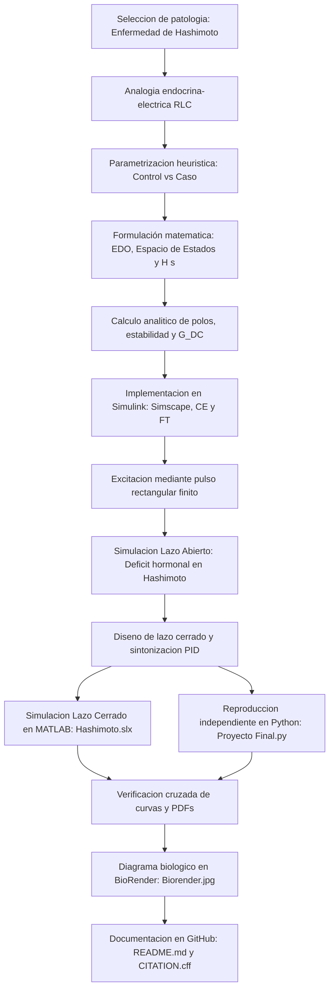

[](https://matlab.mathworks.com/open/github/v1?repo=DrPaulValle/MSFBP0)

# Proyecto Final — Modelado y control del eje hipotálamo-hipófisis-tiroides en la enfermedad de Hashimoto

Repositorio académico del proyecto final de la asignatura **Modelado de Sistemas Fisiológicos**, correspondiente al programa de **Ingeniería Biomédica** del Tecnológico Nacional de México / Instituto Tecnológico de Tijuana. Este proyecto integra modelado matemático endocrino compartimental, analogías eléctricas de segundo orden, análisis temporal y de estabilidad, diseño y sintonización de controladores PID en lazo cerrado, simulación computacional *in silico* y verificación cruzada multiplataforma.

El caso de estudio representa la **dinámica de secreción y regulación hormonal de la unidad glandular tiroidea** (acople TSH $\rightarrow$ glándula tiroides $\rightarrow$ concentración plasmática de $fT_4/fT_3$) mediante un **circuito eléctrico equivalente RLC**. Se analiza y compara el comportamiento de un individuo **sano (Control)** frente a un escenario patológico simulado: **enfermedad de Hashimoto / tiroiditis linfocítica crónica (Caso)**. Posteriormente, se diseña una estrategia de control *in silico* mediante un controlador PID para compensar el déficit hormonal severo y llevar la respuesta patológica hacia el comportamiento fisiológico de referencia.

**Docente:** Dr. Paul Antonio Valle Trujillo  
**Correo:** paul.valle@tectijuana.edu.mx  
**Departamento:** Ingeniería Eléctrica y Electrónica  
**Institución:** Tecnológico Nacional de México / Instituto Tecnológico de Tijuana  
**Asignatura:** Modelado de Sistemas Fisiológicos  
**Programa:** Ingeniería Biomédica  

**Estudiantes:**
* Castañeda Nieblas Lorena Lizel · `L23210695` · L23210695@tectijuana.edu.mx
* Preciado Amezquita Carlos Samuel · `C19211840` · LC19211840@tectijuana.edu.mx
* Rincón Jiménez Tessa · `L22210795` · L22210795@tectijuana.edu.mx
* Vázquez Alvear Nicole · `C20210923` · LC20210923@tectijuana.edu.mx

**Repositorio de la asignatura:** https://github.com/DrPaulValle/MSF-IBF1020  
**Sede:** Blvd. Alberto Limón Padilla s/n, Tijuana, C. P. 22454, B. C., México.

---

<a id="contenido"></a>
## Contenido

1. [Resumen](#resumen)
2. [Competencia y objetivos](#objetivos)
3. [Relación con el temario](#temario)
4. [Modelo físico y analogía eléctrica](#analogia)
5. [Formulación matemática](#modelo)
6. [Análisis temporal, polos y estabilidad](#analisis)
7. [Señal de entrada y condiciones de simulación](#senales)
8. [Implementación en MATLAB, Simulink y Simscape](#matlab)
9. [Control en lazo cerrado y sintonización PID](#pid)
10. [Reproducción en Python](#python)
11. [Verificación cruzada y discusión](#resultados)
12. [Flujo de trabajo](#flujo)
13. [Actividades del equipo](#actividades)
14. [Estructura del repositorio](#estructura)
15. [Requisitos](#requisitos)
16. [Reproducibilidad y entregables](#reproducibilidad)
17. [Referencias](#referencias)

---

<a id="resumen"></a>
## Resumen

Este proyecto final tiene como propósito **modelar, analizar y controlar la dinámica endocrina del eje hipotálamo-hipófisis-tiroides (HHT)** empleando una analogía eléctrica compartimental RLC de segundo orden. Mediante esta equivalencia, el estímulo trófico de tirotropina (TSH) se representa como el voltaje de entrada $V_{in}(t)$ y la concentración sérica de hormonas tiroideas libres ($fT_4/fT_3$) como el voltaje nodal de salida $V_{out}(t)$. El sistema posee dos elementos independientes de almacenamiento de energía (la capacitancia $C_1$ y la inductancia $L_1$), constituyendo un sistema lineal de segundo orden.

Se estudian dos estados fisiológicos definidos a partir de variaciones paramétricas en la resistencia biosintética glandular ($R_1$), la capacitancia de almacenamiento coloide ($C_1$) y la resistencia de aclaramiento periférico ($R_2$): **Control / Sano** ($R_1 = 1\,\mathrm{k\Omega}, R_2 = 100\,\mathrm{k\Omega}, C_1 = 1\,\mathrm{\mu F}, L_1 = 100\,\mathrm{mH}$) y **Caso / Enfermedad de Hashimoto** ($R_1 = 10\,\mathrm{k\Omega}, R_2 = 1\,\mathrm{k\Omega}, C_1 = 0.1\,\mathrm{\mu F}, L_1 = 100\,\mathrm{mH}$). Se deducen analíticamente las funciones de transferencia $H(s)$, el espacio de estados y las ecuaciones diferenciales del sistema, evaluando la estabilidad mediante los polos en el plano complejo y el error en estado estacionario.

Ante una señal de excitación tipo pulso rectangular finito (que emula una prueba clínica de estimulación aguda o pulso secretor hipofisario), se comparan las respuestas en lazo abierto y se implementa un esquema de control PID retroalimentado para corregir el déficit hormonal severo ($G_{DC} \approx 0.091$) y forzar al modelo con tiroiditis de Hashimoto a seguir la respuesta fisiológica del individuo sano. La validación se realiza mediante simulación cruzada en MATLAB/Simulink, Simscape Electrical y Python.

**Palabras clave:** Eje hipotálamo-hipófisis-tiroides; enfermedad de Hashimoto; analogía eléctrica RLC; modelado compartimental; controlador PID; espacio de estados; MATLAB; Simulink; Simscape Electrical; Python; simulación *in silico*.

[Volver al contenido](#contenido)

---

<a id="objetivos"></a>
## Competencia y objetivos

### Competencia a desarrollar

Modelizar sistemas fisiológicos endocrinos mediante circuitos eléctricos equivalentes, ecuaciones diferenciales y funciones de transferencia para analizar su comportamiento dinámico, así como diseñar estrategias de control mediante técnicas de control clásico para compensar déficits hormonales en casos patológicos respecto a respuestas fisiológicas de referencia.

### Objetivo general

Formular el modelo matemático del acople TSH-tiroides basado en un circuito RLC de topología invariante, analizar su respuesta temporal y estabilidad ante las alteraciones fisiopatológicas propias de la enfermedad de Hashimoto, y diseñar un controlador PID retroalimentado *in silico* para restablecer los niveles séricos de hormonas tiroideas respecto al individuo sano de referencia.

### Objetivos específicos

- Identificar la correspondencia biofísica y fenomenológica entre variables endocrinas (concentración de TSH y $fT_4/fT_3$) y eléctricas (voltaje y corriente).
- Formular las ecuaciones diferenciales, la representación en espacio de estados y la función de transferencia $H(s) = V_{out}(s)/V_{in}(s)$.
- Calcular analíticamente los polos y verificar la estabilidad de las condiciones Control (sano) y Caso (Hashimoto).
- Determinar la ganancia en estado estacionario ($G_{DC}$) y el error en régimen permanente ante entradas de prueba.
- Construir e implementar el modelo en MATLAB/Simulink mediante ecuaciones de estado (`CE`), funciones de transferencia (`FT`) y Simscape Electrical.
- Implementar un lazo de control retroalimentado y sintonizar las ganancias PID ($k_P, k_I, k_D$) para compensar la atenuación hormonal del caso patológico.
- Reproducir las simulaciones en lazo abierto y lazo cerrado mediante Python.
- Elaborar un diagrama biológico (vía BioRender) relacionando las estructuras del eje HHT y los folículos tiroideos con los elementos $R_1, R_2, C_1, L_1$.

[Volver al contenido](#contenido)

---

<a id="temario"></a>
## Relación con el temario

Este proyecto integra contenidos de las tres unidades fundamentales de la asignatura **Modelado de Sistemas Fisiológicos (IBF-1020)**:

| Unidad | Área | Contenidos aplicados |
|---|---|---|
| I | Sistemas de control retroalimentados | Diagramas de bloques, señal de error $e(t)$, respuesta dinámica y criterios de estabilidad |
| II | Modelado matemático | Analogía endocrina-eléctrica, leyes de Kirchhoff, espacio de estados y función de transferencia RLC |
| III | Controladores | Controladores PID, sintonización de ganancias y seguimiento de referencias fisiológicas |

[Volver al contenido](#contenido)

---

<a id="analogia"></a>
## Modelo físico y analogía eléctrica

La unidad glandular tiroidea y su dinámica de secreción hormonal se aproximan mediante un **circuito eléctrico RLC de segundo orden** con topología invariante.

```
       +--- R1 ---+
       |          |
Vin(t)-+          +---+----- Vout(t)
                  |   |
                  C1  L1
                  |   |
                  |   R2
                  |   |
                 GND GND
```

### Analogía endocrina–eléctrica

| Variable / Elemento | Símbolo | Unidades Eléctricas | Propiedad Fisiológica Representada | Justificación Biofísica |
|---|---|---|---|---|
| Voltaje de entrada | $V_{in}(t)$ | Voltios ($\mathrm{V}$) | Concentración plasmática o pulso de TSH | Fuerza impulsora adenohipofisaria que estimula los receptores de membrana folicular. |
| Voltaje nodal de salida | $V_{out}(t)$ | Voltios ($\mathrm{V}$) | Concentración sérica de $fT_4 / fT_3$ libres | Variable intensiva resultante del balance entre síntesis, reserva coloide y aclaramiento. |
| Resistencia serie | $R_1$ | Ohmios ($\Omega$) | Resistencia a la síntesis y secreción tiroidea | Impedancia bioquímica y folicular; aumenta en Hashimoto por destrucción autoinmune (anti-TPO). |
| Capacitor en paralelo | $C_1$ | Faradios ($\mathrm{F}$) | Capacidad de almacenamiento hormonal | Reserva de tiroglobulina en el coloide intrafolicular y volumen de distribución plasmático. |
| Resistencia paralela | $R_2$ | Ohmios ($\Omega$) | Tasa de aclaramiento metabólico periférico | Vía de salida, desyodación y excreción continua de hormona hacia tejidos diana. |
| Inductor en paralelo | $L_1$ | Henrios ($\mathrm{H}$) | Retardo dinámico de transducción intracelular | Aproximación fenomenológica de segundo orden para capturar el desfase temporal secreto-estimulatorio. |

### Parámetros eléctricos por condición fisiológica

| Componente eléctrico | Control (Sano) | Caso (Hashimoto) | Variación | Unidades |
|---|---:|---:|---|---|
| Resistencia serie ($R_1$) | $1$ | $10$ | Incremento ($\times 10$) | $\mathrm{k\Omega}$ |
| Resistencia paralela ($R_2$) | $100$ | $1$ | Disminución ($\div 100$) | $\mathrm{k\Omega}$ |
| Capacitor ($C_1$) | $1$ | $0.1$ | Disminución ($\div 10$) | $\mathrm{\mu F}$ |
| Inductor ($L_1$) | $100$ | $100$ | Constante (sin cambio) | $\mathrm{mH}$ |

> **Nota fisiopatológica:** En la enfermedad de Hashimoto, la infiltración linfocítica y los anticuerpos anti-TPO destruyen los folículos tiroideos, elevando la resistencia biosintética ($R_1$) y agotando el reservorio coloide ($C_1$). Heurísticamente, la reducción de $R_2$ se emplea para reflejar la caída pronunciada en la amplitud hormonal circulante ($G_{DC} \approx 0.091$).

[Volver al contenido](#contenido)

---

<a id="modelo"></a>
## Formulación matemática

### 1. Ecuaciones diferenciales del circuito

A partir de la ley de corrientes de Kirchhoff en el nodo central ($I_{R1} = I_{C1} + I_{L1}$) y las relaciones constitutivas de cada elemento pasivo:

$$I_{R1}(t) = \frac{V_{in}(t) - V_{out}(t)}{R_1}, \quad I_{C1}(t) = C_1 \frac{dV_{out}(t)}{dt}, \quad V_{out}(t) = L_1 \frac{dI_{L1}(t)}{dt} + R_2 I_{L1}(t)$$

Despejando la dinámica de la salida hormonal $V_{out}(t)$:

$$\boxed{C_1 \frac{dV_{out}(t)}{dt} = \frac{V_{in}(t) - V_{out}(t)}{R_1} - I_{L1}(t)}$$

### 2. Representación en Espacio de Estados

Seleccionando como variables de estado $x_1(t) = I_{L1}(t)$ (corriente en la rama inductiva) y $x_2(t) = V_{out}(t)$ (voltaje nodal / concentración hormonal), con entrada $u(t) = V_{in}(t)$ y salida $y(t) = V_{out}(t)$:

$$\begin{bmatrix} \dot{I}_{L1}(t) \\ \dot{V}_{out}(t) \end{bmatrix} = \begin{bmatrix} -\frac{R_2}{L_1} & \frac{1}{L_1} \\ -\frac{1}{C_1} & -\frac{1}{R_1 C_1} \end{bmatrix} \begin{bmatrix} I_{L1}(t) \\ V_{out}(t) \end{bmatrix} + \begin{bmatrix} 0 \\ \frac{1}{R_1 C_1} \end{bmatrix} V_{in}(t)$$

$$y(t) = \begin{bmatrix} 0 & 1 \end{bmatrix} \begin{bmatrix} I_{L1}(t) \\ V_{out}(t) \end{bmatrix}$$

### 3. Función de transferencia $H(s)$

Aplicando la Transformada de Laplace con condiciones iniciales nulas:

$$\frac{V_{in}(s) - V_{out}(s)}{R_1} = s C_1 V_{out}(s) + \frac{V_{out}(s)}{s L_1 + R_2}$$

Agrupando términos y resolviendo algebraicamente:

$$\boxed{H(s) = \frac{V_{out}(s)}{V_{in}(s)} = \frac{s L_1 + R_2}{s^2 (R_1 L_1 C_1) + s (L_1 + R_1 R_2 C_1) + (R_1 + R_2)}}$$

Sustituyendo los valores numéricos de cada condición fisiológica:

- **Control / Sano ($R_1=1\,\mathrm{k\Omega}, R_2=100\,\mathrm{k\Omega}, C_1=1\,\mathrm{\mu F}, L_1=0.1\,\mathrm{H}$):**
  $$H_{\mathrm{control}}(s) = \frac{0.1s + 100000}{0.1s^2 + 100.1s + 101000} = \frac{s + 1\times 10^6}{s^2 + 1001s + 1.01\times 10^6}$$
- **Caso / Hashimoto ($R_1=10\,\mathrm{k\Omega}, R_2=1\,\mathrm{k\Omega}, C_1=0.1\,\mathrm{\mu F}, L_1=0.1\,\mathrm{H}$):**
  $$H_{\mathrm{caso}}(s) = \frac{0.1s + 1000}{1\times 10^{-4}s^2 + 1.1s + 11000} = \frac{1000s + 1\times 10^7}{s^2 + 11000s + 1.1\times 10^8}$$

[Volver al contenido](#contenido)

---

<a id="analisis"></a>
## Análisis temporal, polos y estabilidad

### 1. Ganancia en estado estacionario ($G_{DC}$) y déficit hormonal

Evaluando la función de transferencia en régimen permanente ($s \to 0$) ante un estímulo sostenido:

$$G_{DC} = \lim_{s \to 0} H(s) = \frac{R_2}{R_1 + R_2}$$

- **Control (Sano):** $G_{DC,\mathrm{control}} = \frac{100}{1 + 100} \approx 0.9901$ ($99.01\%$ de respuesta respecto al estímulo).
- **Caso (Hashimoto):** $G_{DC,\mathrm{caso}} = \frac{1}{10 + 1} \approx 0.0909$ ($9.09\%$ de respuesta, evidenciando una atenuación superior al $90\%$).

### 2. Polos del sistema y estabilidad

Los polos $\lambda_{1,2}$ corresponden a las raíces del polinomio característico $s^2 (R_1 L_1 C_1) + s (L_1 + R_1 R_2 C_1) + (R_1 + R_2) = 0$:

| Condición | Polos ($\lambda_1, \lambda_2$) | Naturaleza dinámica | Estabilidad |
|---|---|---|---|
| **Control (Sano)** | $\lambda_{1,2} = -500.5 \pm 871.49i\;\mathrm{rad/s}$ | Subamortiguado (par complejo conjugado) | **Estable** ($\mathrm{Re} < 0$) |
| **Caso (Hashimoto)** | $\lambda_1 = -5500 + 8930.29i, \quad \lambda_2 = -5500 - 8930.29i\;\mathrm{rad/s}$ | Subamortiguado de alta frecuencia natural ($\omega_n = \frac{1}{\sqrt{L_1 C_1}}$) | **Estable** ($\mathrm{Re} < 0$) |

**Conclusión de estabilidad:** Ambos sistemas son asintóticamente estables ($\mathrm{Re}(\lambda) < 0$). Sin embargo, en el Caso (Hashimoto) la disminución de $C_1$ incrementa la frecuencia natural del sistema y reduce drásticamente el tiempo de establecimiento, traduciendo el agotamiento rápido de una reserva folicular disminuida.

[Volver al contenido](#contenido)

---

<a id="senales"></a>
## Señal de entrada y condiciones de simulación

Para evaluar tanto la capacidad secretora máxima como la cinética de aclaramiento hormonal, se selecciona una excitación tipo **pulso rectangular de duración finita**:

$$V_{in}(t) = V_0 + A\left[u(t - t_1) - u(t - t_2)\right]$$

- **Significado fisiológico:** Emula una prueba clínica de estimulación aguda (como la administración exógena de TRH para evaluar la reserva tiroidea) o un pulso secretor hipofisario de TSH.
- **Parametrización normalizada (Simulink):**
  - Nivel basal: $V_0 = 0\,\mathrm{V}$ (desviación respecto al equilibrio basal).
  - Amplitud del pulso: $A = 1\,\mathrm{V}$ (o escalado normalizado a $5\,\mathrm{V}$ según prueba).
  - Inicio y duración: $t_1 = 0.01\,\mathrm{s}$, $\Delta t = 0.04\,\mathrm{s}$ ($t_2 = 0.05\,\mathrm{s}$), ventana total $T_{sim} = 0.10\,\mathrm{s}$ (escala temporal académica dictada por las constantes $\tau$ del circuito RLC).

[Volver al contenido](#contenido)

---

<a id="matlab"></a>
## Implementación en MATLAB, Simulink y Simscape

Se construyen e integran tres representaciones computacionales equivalentes dentro del entorno de MATLAB/Simulink (`Hashimoto.slx`):

1. **Circuito equivalente (Simscape Electrical):** Ensamblado físico-eléctrico con fuente controlada de voltaje, resistencias $R_1, R_2$, capacitor $C_1$, inductor $L_1$, referencia eléctrica y sensor de voltaje nodal.
2. **Función de Transferencia (`FT`):** Mediante bloques `Transfer Fcn` configurados con los polinomios de $H_{\mathrm{control}}(s)$ y $H_{\mathrm{caso}}(s)$.
3. **Ecuaciones de Estado (`CE`):** Mediante bloques `State-Space` cargando las matrices $A, B, C, D$ deducidas.

El cuaderno computacional `ProyectoFinal.mlx` automatiza la carga de parámetros, ejecuta el modelo de Simulink, recupera las señales del *Workspace* y exporta los resultados gráficos (`Hashimoto_matlab.pdf`, `ProyectoFinal.pdf` y `Respuesta de Hashimoto.pdf`).

[Volver al contenido](#contenido)

---

<a id="pid"></a>
## Control en lazo cerrado y sintonización PID

### Esquema de control terapéutico *in silico*

Para corregir el hipotiroidismo primario simulado en el Caso (Hashimoto), se implementa un lazo cerrado donde la respuesta del individuo sano $V_{out,\mathrm{control}}(t)$ actúa como la **referencia fisiológica ideal**:

$$e(t) = V_{out,\mathrm{control}}(t) - V_{out,\mathrm{caso}}(t)$$

```
                 +-------------------+
                 |  Individuo sano   |---> Vout,control(t) [Referencia]
           +---->|     (Control)     |--------+
           |     +-------------------+        |
Vin(t) ----+                                  | +  -
 (Pulso)   |     +-------------------+        ( Σ )---> [ PID ] ---> [ Paciente ] ---> Vout,tratado(t)
           +---->|     Paciente      |        ^                      (Hashimoto)
                 | (Caso Hashimoto)  |        |
                 +-------------------+        +--- Vout,caso(t) (Retroalimentación)
```

### Desempeño del controlador PID

Mediante el ajuste de las ganancias proporcional, integral y derivativa ($k_P, k_I, k_D$) en Simulink (`PID(t): Caso`), la acción de control compensa la caída de ganancia en estado estacionario ($0.091 \to 0.99$), elevando la concentración sérica simulada de hormonas tiroideas hasta alcanzar el nivel eutiroideo de referencia sin inestabilidad.

[Volver al contenido](#contenido)

---

<a id="python"></a>
## Reproducción en Python

Mediante el script `Proyecto Final.py` (utilizando `numpy`, `scipy.signal` y `matplotlib`), se realiza la validación numérica independiente:

1. Definición de los parámetros eléctricos para Control y Caso (`parametros.jpg`).
2. Construcción de las funciones de transferencia y modelos en espacio de estados mediante `scipy.signal.TransferFunction` y `StateSpace`.
3. Simulación de la respuesta en lazo abierto ante el pulso rectangular de excitación usando `scipy.signal.lsim`.
4. Implementación de la función de transferencia en lazo cerrado con el controlador PID y comparación cruzada contra las curvas obtenidas en MATLAB/Simulink.

[Volver al contenido](#contenido)

---

<a id="resultados"></a>
## Verificación cruzada y discusión

### Equivalencia multiplataforma

Se verifica la coincidencia exacta entre las tres formulaciones matemáticas y las dos plataformas de simulación:
- **Simscape Electrical** (`Vs(t): Control`, `Vs(t): Caso`).
- **Ecuaciones de Estado en Simulink** (`Vs(t): Control CE`, `Vs(t): Caso CE`).
- **Función de Transferencia en Simulink** (`Vs(t): Control FT`, `Vs(t): Caso FT`).
- **Simulación en Python** (`Proyecto Final.py`).

### Limitaciones del modelo y rigor biofísico

1. **Linealidad (LTI):** El circuito RLC aproxima linealmente fenómenos endocrinos no lineales (como la cinética enzimática de Michaelis-Menten de la TPO y la unión a proteínas transportadoras TBG).
2. **Carácter fenomenológico del inductor $L_1$:** No existe inductancia electromagnética real en la glándula tiroides; $L_1$ emula matemáticamente el retardo de fase en la transducción intracelular de señales.
3. **Aclaramiento periférico ($R_2$):** Aunque fisiológicamente el hipotiroidismo reduce el catabolismo hormonal, la disminución heurística de $R_2$ permitió reproducir didácticamente la atenuación severa en estado estacionario observada en la enfermedad de Hashimoto avanzada.

[Volver al contenido](#contenido)

---

<a id="flujo"></a>
## Flujo de trabajo



[Volver al contenido](#contenido)

---

<a id="actividades"></a>
## Actividades del equipo

### Etapa 1. Formulación y análisis analítico

- [x] Seleccionar el sistema endocrino y la enfermedad de Hashimoto como caso de estudio.
- [x] Establecer la tabla de correspondencia biofísica y parámetros heurísticos ($R_1, R_2, C_1, L_1$).
- [x] Derivar manualmente las ecuaciones diferenciales, el espacio de estados y la función de transferencia $H(s)$ (`proyecto_calculos.pdf`).
- [x] Calcular analíticamente los polos, la estabilidad y la ganancia $G_{DC}$ para Control y Caso.

### Etapa 2. Simulación computacional

- [x] Construir el modelo en Simulink integrando Simscape Electrical, Espacio de Estados (`CE`) y Función de Transferencia (`FT`) (`Hashimoto.slx`).
- [x] Justificar y configurar la señal de excitación tipo pulso rectangular.
- [x] Obtener y comparar las respuestas de lazo abierto evidenciando la atenuación del caso patológico.

### Etapa 3. Control, validación y entrega

- [x] Diseñar el lazo de retroalimentación y sintonizar el controlador `PID(t): Caso`.
- [x] Automatizar la ejecución y generación de gráficas en MATLAB (`ProyectoFinal.mlx` y `ProyectoFinal.pdf`).
- [x] Reproducir las simulaciones de forma independiente en Python (`Proyecto Final.py`).
- [x] Elaborar el diagrama biológico del eje HHT y folículo tiroideo (`Biorender.jpg`).
- [x] Integrar la bitácora, actualizar `README.md` y publicar `CITATION.cff`.

[Volver al contenido](#contenido)

---

<a id="estructura"></a>
## Estructura del repositorio

```text
.
├── README.md                      # Reporte principal del Proyecto Final
├── CITATION.cff                   # Metadatos de citación del repositorio
├── LICENSE                        # Licencia académica del proyecto
├── Biorender.jpg                  # Diagrama biológico del eje HHT y tiroides (BioRender)
├── Hashimoto.slx                  # Modelo Simulink (Simscape, Estados, FT y PID)
├── Hashimoto_matlab.pdf           # Gráficas de simulación exportadas desde MATLAB
├── Proyecto Final.py              # Script de reproducción y validación en Python
├── ProyectoFinal.mlx              # Cuaderno computacional MATLAB de automatización
├── ProyectoFinal.pdf              # Exportación completa del cuaderno MATLAB
├── Respuesta de Hashimoto.pdf     # Evidencia gráfica de respuesta dinámica del sistema
├── parametros.jpg                 # Tabla/captura de parámetros eléctricos Control vs Caso
└── proyecto_calculos.pdf          # Desarrollo analítico manuscrito (FT, polos y estabilidad)
```

[Volver al contenido](#contenido)

---

<a id="requisitos"></a>
## Requisitos

### Software

- **MATLAB y Simulink** (con Control System Toolbox y Simscape Electrical).
- **Python 3.x** (con `numpy`, `scipy`, `matplotlib`) y **Visual Studio Code**.
- **BioRender** para la ilustración esquemática del eje hipotálamo-hipófisis-tiroides.
- **Git y GitHub** para control de versiones.

[Volver al contenido](#contenido)

---

<a id="reproducibilidad"></a>
## Reproducibilidad y entregables

1. Clonar este repositorio en su equipo local.
2. Abrir `ProyectoFinal.mlx` en MATLAB y ejecutar todas las secciones para cargar los parámetros, compilar el modelo `Hashimoto.slx` y regenerar `ProyectoFinal.pdf` y `Hashimoto_matlab.pdf`.
3. Ejecutar `Proyecto Final.py` en Visual Studio Code para corroborar la equivalencia numérica entre Python y Simulink.
4. Consultar el desarrollo matemático detallado en `proyecto_calculos.pdf` y el diagrama fisiológico en `Biorender.jpg`.

[Volver al contenido](#contenido)

---

<a id="referencias"></a>
## Referencias

[1] J. Berberich, J. W. Dietrich, R. Hoermann y M. A. Müller, "Mathematical modeling of the pituitary-thyroid feedback loop: Role of a TSH-T3-shunt and sensitivity analysis," *Frontiers in Endocrinology*, vol. 9, p. 91, 2018. https://doi.org/10.3389/fendo.2018.00091

[2] P. Caturegli, A. De Remigis y N. R. Rose, "Hashimoto thyroiditis: Clinical and diagnostic criteria," *Autoimmunity Reviews*, vol. 13, no. 4-5, pp. 391–397, 2014. https://doi.org/10.1016/j.autrev.2014.01.007

[3] J. E. Hall y M. E. Hall, *Guyton y Hall. Tratado de fisiología médica*, 14.ª ed., Elsevier, 2021.

[4] M. C. K. Khoo, *Physiological Control Systems: Analysis, Simulation, and Estimation*, 2nd ed., Wiley-IEEE Press, 2018. https://doi.org/10.1002/9781119058786

[5] M. Ralli et al., "Hashimoto's thyroiditis: An update on pathogenic mechanisms, diagnostic protocols, therapeutic strategies, and potential malignant transformation," *Autoimmunity Reviews*, vol. 19, no. 10, p. 102649, 2020. https://doi.org/10.1016/j.autrev.2020.102649

[6] P. A. Valle, *Syllabus para Modelado de Sistemas Fisiológicos*, Tecnológico Nacional de México / Instituto Tecnológico de Tijuana, Tijuana, B. C., México, 2026. Disponible en: https://biomath.xyz/course/

[7] Tecnológico Nacional de México, *Programa de estudio de la asignatura Modelado de Sistemas Fisiológicos, IBF-1020*.

---

## Uso académico

Este repositorio constituye la evidencia del desarrollo del **Proyecto Final** de la asignatura **Modelado de Sistemas Fisiológicos**. Las estrategias de modelado y control desarrolladas tienen propósitos estrictamente académicos y de simulación *in silico*, y no constituyen recomendaciones ni protocolos clínicos terapéuticos reales.